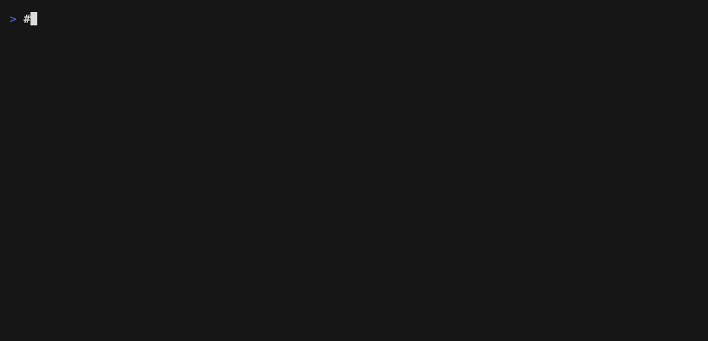

<div align="center">

# 🧠⚡ Claude Code Local

### Claude Code, running on your own Mac. No cloud. No API key. No waiting.

**Your Mac's chip runs the AI · Claude Code works exactly like it always does · nothing leaves your computer**

**Now on Linux and Windows too, same Claude Code, same privacy, your own machine doing the work. [Phones are next.](#-where-this-is-going)**

<a href="https://github.com/hesreallyhim/awesome-claude-code"></a>

<a href="https://github.com/nicedreamzapp/claude-code-local/actions/workflows/ci.yml"></a>
<a href="https://scorecard.dev/viewer/?uri=github.com/nicedreamzapp/claude-code-local"></a>
<a href="https://github.com/nicedreamzapp/claude-code-local/stargazers"></a>
<a href="#-what-you-need"></a>
<a href="#-your-code-stays-home"></a>
<a href="#-use-it-with-trinidad-head"></a>
<a href="LICENSE"></a>
<a href="https://discord.gg/ZdSqgAxUW"></a>

<a href="https://www.youtube.com/watch?v=XNSdQtlTwWo"></a>

</div>

**In one sentence:** a small Python server ([`proxy/server.py`](proxy/server.py)) runs open AI models on your Mac's chip with Apple's MLX and answers Claude Code in Anthropic's own API format, so Claude Code works with no cloud model and no API key.

Ran out of Claude usage or hit a rate limit mid-task? [Start here](#-hit-your-claude-code-usage-limit),
it takes one command to keep working on a local model.

Other things I built that go with it are in [the local-first family](#-the-local-first-family).

<p align="center">
  
  <br><em>A real session, unedited. Claude Code reads and edits the file, and the AI answering is running on the laptop.</em>
</p>

<picture><source media="(max-width: 610px), (min-width: 768px) and (max-width: 895px)" srcset="https://raw.githubusercontent.com/nicedreamzapp/claude-code-local/ce65065a5327476e7fc1f6435116bd31c0e0e80d/assets/readme/s01-banner-m.svg"><source media="(max-width: 1149px)" srcset="https://raw.githubusercontent.com/nicedreamzapp/claude-code-local/ce65065a5327476e7fc1f6435116bd31c0e0e80d/assets/readme/s01-banner-mid.svg"></picture>
<picture><source media="(max-width: 610px), (min-width: 768px) and (max-width: 895px)" srcset="https://raw.githubusercontent.com/nicedreamzapp/claude-code-local/ce65065a5327476e7fc1f6435116bd31c0e0e80d/assets/readme/s01-r1-m.svg"><source media="(max-width: 1149px)" srcset="https://raw.githubusercontent.com/nicedreamzapp/claude-code-local/ce65065a5327476e7fc1f6435116bd31c0e0e80d/assets/readme/s01-r1-mid.svg"></picture>

Matt Macosko wrote the glue that makes local models usable inside Claude Code. The pieces in this repo:

- ⚡ **[`proxy/server.py`](proxy/server.py)**: the MLX server. Speaks the Anthropic Messages API with streaming, turns each model's own tool-call format (Gemma 4, Qwen, Llama JSON) into Claude Code tool calls, repairs garbled tool JSON, and reuses the prompt cache between turns so long sessions don't re-read everything.
- 🧪 **[`scripts/test_parse_tool_calls.py`](scripts/test_parse_tool_calls.py)** and **[`scripts/test_mlx_server.py`](scripts/test_mlx_server.py)**: tests for the tool-call parser (no model needed) and for multi-step tool calls against a running server.
- 🏎️ **[`agent/agent.py`](agent/agent.py)**: the Native Engine, a one-file terminal coding agent with a short fixed system prompt so the cache survives every turn. [`bench/agent_bench.py`](bench/agent_bench.py) reproduces its cache numbers.
- 🔋 **[`bin/keepgoing`](bin/keepgoing)** + [`bin/keepgoing.py`](bin/keepgoing.py): finds your last Claude Code conversation in this folder and resumes it on a free cloud or local model.
- 🚀 **[`install.sh`](install.sh)**, **[`setup.sh`](setup.sh)** and **[`scripts/doctor.sh`](scripts/doctor.sh)**: check the Mac, pick a model that fits its memory, install everything and make a Desktop launcher.
- 🩺 **Doctor**: checks the core (Claude Code, model server, model files, Python, llama.cpp) and every add-on you installed. Mac or Linux: `bash scripts/doctor.sh`. Windows: `powershell -ExecutionPolicy Bypass -File scripts\doctor.ps1`. Add `--fix` / `-Fix` to restart your own service that is down or recreate a missing symlink (it never deletes anything), and `--report` / `-Report` for a privacy-safe block to paste into a bug report.
- 🎮 **[`launchers/`](launchers/)** with the shared [`launchers/lib/claude-local-common.sh`](launchers/lib/claude-local-common.sh): the double-click modes below.

**Upstream, not mine:** [Claude Code](https://github.com/anthropics/claude-code) (Anthropic), [MLX and mlx-lm](https://github.com/ml-explore/mlx-lm) (Apple), and the models themselves (Google, Qwen, Nous Research and the others credited [below](#-good-builds-from-other-people)). Contributors who fixed things are named at the bottom.


<picture><source media="(max-width: 610px), (min-width: 768px) and (max-width: 895px)" srcset="https://raw.githubusercontent.com/nicedreamzapp/claude-code-local/ce65065a5327476e7fc1f6435116bd31c0e0e80d/assets/readme/s02-banner-m.svg"><source media="(max-width: 1149px)" srcset="https://raw.githubusercontent.com/nicedreamzapp/claude-code-local/ce65065a5327476e7fc1f6435116bd31c0e0e80d/assets/readme/s02-banner-mid.svg"></picture>
<picture><source media="(max-width: 610px), (min-width: 768px) and (max-width: 895px)" srcset="https://raw.githubusercontent.com/nicedreamzapp/claude-code-local/ce65065a5327476e7fc1f6435116bd31c0e0e80d/assets/readme/s02-r1-m.svg"><source media="(max-width: 1149px)" srcset="https://raw.githubusercontent.com/nicedreamzapp/claude-code-local/ce65065a5327476e7fc1f6435116bd31c0e0e80d/assets/readme/s02-r1-mid.svg"></picture>

### 🛑 Hit your Claude Code usage limit?

Claude Code just said **"5-hour limit reached"**, **"You've reached your weekly limit"**, or your API
key came back with **"credit balance is too low"**, and the reset is hours away? You ran out of Claude
usage, not out of work. Keep going on your own machine: same Claude Code, same project, but the AI
answering runs on your Mac (or your Linux or Windows PC), with no API key and no usage limit.

1. **Install it once** (Mac or Linux; Windows is [below](#-on-linux-or-a-windows-pc)):

   ```bash
   curl -fsSL https://raw.githubusercontent.com/nicedreamzapp/claude-code-local/main/install.sh | bash
   ```

2. **Switch to local.** On a Mac, type `exit` in Claude Code, then `keep going`, and the same
   conversation carries on with a local model. Or double-click **Claude Local** on your Desktop for a
   fresh session (`claude-local` on Linux).
3. **Switch back when your limit resets.** Plain `claude` is never changed by the install, so it
   still uses your Claude plan.

It even works on a **16 GB MacBook**, and gets better the more memory your Mac has. A local model is
not Claude Opus, so keep requests to one clear step at a time on smaller machines. More answers in
the [usage limit FAQ](#-usage-limit-faq) and the
[usage limit guide](https://nicedreamzapp.github.io/claude-code-local/usage-limit/).

Once it's running, [the local-first family](#-the-local-first-family) takes it off the keyboard: your browser, your voice, your phone, all on the same machine.

### 🔋 Out of Claude credits? Keep going.

When Claude runs out, type **`exit`** in Claude Code, then **`keep going`**. You get a short menu,
and **the same conversation carries on** with whichever model you pick:

- ☁️ **Free cloud models** from OpenRouter (add a free key, see below)
- 💻 **Models on your Mac** from the lineup below, sized to fit your memory

<p align="center">
  
</p>

`setup.sh` installs it for you. To add it by hand, or to turn on the free cloud models:

```bash
echo 'source "$HOME/claude-code-local/scripts/keepgoing-shell.sh"' >> ~/.zshrc   # the "keep going" command
mkdir -p ~/.config/claude-code-local
echo 'OPENROUTER_API_KEY=your-free-key' >> ~/.config/claude-code-local/keepgoing.env   # optional
```

Want a reminder at the bottom of every Claude window? Point your status line at
`scripts/statusline-keepgoing.sh`. It says *"💡 Out of Claude credits? Type exit, then keep going to
carry on with a free or local model."*

It can also happen automatically. Add one hook to Claude Code and, the moment you hit your usage
limit, a new window opens in the same folder and carries on without a menu, free cloud model first,
then one on your Mac. Setup and limits are in [Automatic keep going](docs/AUTO-HANDOFF.md).

> 💡 Free cloud models can get busy later in the day. The models on your Mac are always there.


<picture><source media="(max-width: 610px), (min-width: 768px) and (max-width: 895px)" srcset="https://raw.githubusercontent.com/nicedreamzapp/claude-code-local/ce65065a5327476e7fc1f6435116bd31c0e0e80d/assets/readme/s03-banner-m.svg"><source media="(max-width: 1149px)" srcset="https://raw.githubusercontent.com/nicedreamzapp/claude-code-local/ce65065a5327476e7fc1f6435116bd31c0e0e80d/assets/readme/s03-banner-mid.svg"></picture>
<picture><source media="(max-width: 610px), (min-width: 768px) and (max-width: 895px)" srcset="https://raw.githubusercontent.com/nicedreamzapp/claude-code-local/ce65065a5327476e7fc1f6435116bd31c0e0e80d/assets/readme/s03-r1-m.svg"><source media="(max-width: 1149px)" srcset="https://raw.githubusercontent.com/nicedreamzapp/claude-code-local/ce65065a5327476e7fc1f6435116bd31c0e0e80d/assets/readme/s03-r1-mid.svg"></picture>

### 🤔 What is this, really?

Your Mac has a powerful graphics chip built in. This project uses it to run **big AI models right on
your computer** and plugs them into Claude Code, so the whole coding experience works offline:
editing files, managing projects, even driving your browser or talking out loud.

**The trick:** Claude Code speaks one language (Anthropic's), and local AI servers usually speak
another (OpenAI's). Most setups put a slow translator in between. This project's server speaks
Claude Code's language directly, so there's **nothing in the middle**, and that's what makes it fast.

```
📝 You  ──▶  🤖 Claude Code  ──▶  ⚡ this server (on your Mac)  ──▶  🧠 local model  ──▶  🖥️ your Mac's chip
```

### 💻 What you need

- 🍎 A Mac with **Apple Silicon** (M1 or newer)
- 🐍 **Python 3.12** (setup installs it for you)
- 🤖 **Claude Code**: `npm install -g @anthropic-ai/claude-code`

Setup looks at your Mac's memory and picks a model that fits:

| Your Mac's memory | The model you get |
|---|---|
| **Under 16 GB** (8 GB) | 🟡 Qwen 3.5 2B, 8-bit. Reads images, 16K context, server peaks at 4.2 GB. [Small Macs](docs/SMALL-MACS.md) |
| **16 GB** (MacBook Air, base models) | 🟡 Qwen 3.5 4B, bf16. Reads images, 16K context, server peaks at 10.6 GB. [Small Macs](docs/SMALL-MACS.md) |
| **32–63 GB** (Pro) | 🟢 Gemma 4 12B |
| **64–95 GB** (Max) | 🟢 Gemma 4 31B |
| **96 GB and up** (Max, Ultra) | 🟣 Qwen 3.8 27B, 8-bit. Passed our Claude Code test (write a file, run it, report) in 38 s |

### 💻 On an 8 GB or 16 GB Mac?

`setup.sh` sees it and sets up the small-Mac tier for you: a model that reads files, edits them,
runs commands and looks at images, with the context capped to what your Mac can hold.

| Your Mac | Model | Server memory, peak | Speed (M4 Pro) |
|---|---|:---:|:---:|
| 16 GB | Qwen 3.5 4B, bf16 | 10.6 GB | 22 tok/s |
| 8 GB | Qwen 3.5 2B, 8-bit | 4.2 GB | 92 tok/s |

Both passed our Claude Code test (read a file, fix a bug with Edit, run a script, describe an
image). Keep requests to one clear step at a time. Measured numbers, settings and limits:
[docs/SMALL-MACS.md](docs/SMALL-MACS.md). Running one? Tell us how it goes in
[#57](https://github.com/nicedreamzapp/claude-code-local/issues/57).

### 🚀 Get started

**One command:**

```bash
curl -fsSL https://raw.githubusercontent.com/nicedreamzapp/claude-code-local/main/install.sh | bash
```

**Or read the script first:**

```bash
git clone https://github.com/nicedreamzapp/claude-code-local
cd claude-code-local
bash setup.sh
```

Setup picks your model, downloads it, installs the server, and puts **`Claude Local.command`** on
your Desktop. **Double-click it** and you're coding locally. 🎉

### 🧰 The full kit

The local model is the brain. The add-ons give it ears, a voice, hands and reach, and one command
installs all of it:

```bash
curl -fsSL https://raw.githubusercontent.com/nicedreamzapp/claude-code-local/main/install.sh | bash -s -- --with all
```

| Add-on | What it gives you | Mac | Windows |
|---|---|:---:|:---:|
| `voice` | [NarrateClaude](https://github.com/nicedreamzapp/NarrateClaude): talk to Claude Code and hear it answer | ✅ | ✅ |
| `moonstone` | [Moonstone](https://github.com/nicedreamzapp/moonstone): every session on every machine in one window, push to talk | ✅ | ✅ |
| `browser` | [browser-agent](https://github.com/nicedreamzapp/browser-agent): agents use your real, logged in browser, each in its own tab | ✅ | ✅ |
| `phone` | [claude-screen-to-phone](https://github.com/nicedreamzapp/claude-screen-to-phone): drive Claude Code from your iPhone over iMessage | ✅ | |
| `remote` | [FiaOS](https://github.com/nicedreamzapp/FiaOS): your screen and a real terminal from any browser | ✅ | ✅ |
| `failover` | [claude-failover](https://github.com/nicedreamzapp/claude-failover): background agents keep working on the local model when you hit your Claude limit | ✅ | |
| `terminal` | [Trinidad Head](https://github.com/nicedreamzapp/trinidad-head): a glowing terminal with a color per window | | ✅ |

Every piece is its own repo with its own one-line installer and uninstaller, so you can take one
and leave the rest.

**Add-ons (macOS).** After the model is set up, setup offers a menu of add-ons. Each is its own repo,
installed by that repo's own one-line installer: `voice` ([NarrateClaude](https://github.com/nicedreamzapp/NarrateClaude)),
`browser` ([browser-agent](https://github.com/nicedreamzapp/browser-agent)), `phone` ([claude-screen-to-phone](https://github.com/nicedreamzapp/claude-screen-to-phone)),
`remote` ([FiaOS](https://github.com/nicedreamzapp/FiaOS)), `moonstone` ([Moonstone](https://github.com/nicedreamzapp/moonstone))
and `failover` ([claude-failover](https://github.com/nicedreamzapp/claude-failover)). Skip the menu:

```bash
curl -fsSL https://raw.githubusercontent.com/nicedreamzapp/claude-code-local/main/install.sh | bash -s -- --with voice,browser,phone
curl -fsSL https://raw.githubusercontent.com/nicedreamzapp/claude-code-local/main/install.sh | bash -s -- --with all
bash ~/claude-code-local/scripts/addons.sh menu      # add more later
```

With no terminal to ask on and no `--with`, no add-ons are installed.

**Uninstall:** `bash ~/claude-code-local/uninstall.sh` (add `--with phone,remote` or `--all` to remove add-ons too, `--purge` to delete their data).

> 🐛 **Asked to sign in to a Claude account?** Your `claude` is too old. Update it:
> `npm install -g @anthropic-ai/claude-code`

<details>
<summary>🛠️ Prefer to do it by hand?</summary>

```bash
# 1. Set up the MLX environment
python3.12 -m venv ~/.local/mlx-server
~/.local/mlx-server/bin/pip install mlx-lm

# 2. Pick a model and download it (one time)
bash scripts/download-and-import.sh gemma   # or 'qwen', 'gemma12', 'hermes'

# 3. Start the server (MLX_SERVER points at the repo copy, since setup.sh didn't install one)
MLX_MODEL=divinetribe/gemma-4-31b-it-abliterated-4bit-mlx \
MLX_SERVER="$PWD/proxy/server.py" \
  bash scripts/start-mlx-server.sh

# 4. Launch Claude Code against it
ANTHROPIC_BASE_URL=http://localhost:4000 \
ANTHROPIC_API_KEY=sk-local \
claude --model claude-sonnet-4-6
```

`setup.sh` installs the server as a **symlink** back to `proxy/server.py` in this repo, so if you edit
it, just restart the server.

</details>


## 🐧🪟 On Linux or a Windows PC

MLX on Apple Silicon is still the heart of this project and always will be, it's what we run every
day. We extended it to everything else so nobody gets left out: the same Claude Code, running on your
own machine, now works on Linux and Windows too. Off a Mac there is no MLX, so the AI runs on
**llama.cpp** instead, and the installer does the whole "download and go" for you: it looks at your
hardware (NVIDIA, AMD, or just your CPU), grabs the right pinned llama.cpp build, picks the best model
that fits your memory at the highest precision it can, downloads it, and launches Claude Code pointed
at it. Phones are the next frontier, we're working on it.

Every model it can pick **can see images**, so screenshots you paste into Claude Code work the same as
they do on the cloud.

**Linux (one command):**

```bash
curl -fsSL https://raw.githubusercontent.com/nicedreamzapp/claude-code-local/main/install.sh | bash
```

**Windows (PowerShell):**

```powershell
irm https://raw.githubusercontent.com/nicedreamzapp/claude-code-local/main/install.ps1 | iex
```

You need **git**, **Python 3**, and **Claude Code** installed. When it finishes, run **`claude-local`**
(Linux) or double-click **Claude Local** on your Desktop (Windows).

On Windows the installer then offers the add-ons that run there, each installed by its own repo's
installer: **moonstone** ([Moonstone](https://github.com/nicedreamzapp/moonstone)), **browser**
([browser-broker](https://github.com/nicedreamzapp/browser-agent)), **remote**
([FiaOS](https://github.com/nicedreamzapp/FiaOS)), **terminal**
([Trinidad Head](https://github.com/nicedreamzapp/trinidad-head)) and **voice**
([NarrateClaude](https://github.com/nicedreamzapp/NarrateClaude)). To skip the menu, set
`$env:CCL_WITH = "all"` (or `"moonstone,terminal"`, or `"none"`) before the one-liner. Uninstall
(set `$env:CCL_WITH = "all"` first to remove the add-ons too; models and user data are kept unless
`$env:CCL_PURGE = "1"`):
`irm https://raw.githubusercontent.com/nicedreamzapp/claude-code-local/main/uninstall.ps1 | iex`

It picks the strongest vision model that fits and tells you why, for example:

| Your hardware | What you get |
|---|---|
| 24 GB NVIDIA card | Qwen 3.5 9B at full BF16 |
| 12 GB NVIDIA card | Qwen 3.5 4B at full BF16 |
| AMD or Vulkan GPU | the largest that fits in VRAM |
| No GPU (CPU only) | a 4B or 9B vision model, sized to your RAM |

Want a specific one? `CCL_MODEL_ID=gemma-4-12b claude-local`. The catalog lives in
[`portable/catalog.json`](portable/catalog.json).

### What it depends on (and how we'd replace it)

We stay independent on purpose. The portable path leans on exactly two outside things:

- **llama.cpp** (MIT licensed) runs the model. We pin an exact release by version and verify its
  checksum, so an upstream change can never move under us. If it ever went away we already ship the
  Mac engine (`proxy/server.py`), and the GGUF format is open.
- **Hugging Face** hosts the model weights. We pin each file's size and SHA-256. If it went down the
  same files mirror anywhere; swap the URL in `portable/catalog.json` and the checksums still hold.

No Ollama, no LM Studio, no company account, no telemetry. The proxy that turns Claude Code's requests
into model calls is our own code, the same hardened translation the Mac build uses.

---

## 🥊 Pick your AI

Same server, same Claude Code. Swap one setting and you swap the brain. Links to every build are just below the table.

Every number below was measured by us on an M5 Max (128 GB), except the rows marked vendor-reported.

| | Model | What we measured | Good for |
|---|---|---|---|
| 🟣 | **Qwen 3.8 27B** | Agent-12 with the DFlash 2 drafter (8-bit, Sep 19): 12/12 easy in 122 s, 7/8 hard in 401 s, 20-29 tok/s inside the harness ([writeup](https://github.com/nicedreamzapp/agent12/blob/main/writeups/qwen38_dflash_rerun.md)). Browser test (Sep 16, bf16): 8/8 | Careful coding and pictures, 96 GB Macs |
| 🟢 | **Gemma 4 31B** (4-bit) | Agent-12: 11/12, 8/8. Browser test (Sep 16): 8/8, about 30% faster than Qwen 3.8 | Daily coding and the browser agent |
| 🟢 | **Gemma 4 12B** (4-bit) | Not on Agent-12 yet | 32 GB Macs |
| 🟡 | **Hermes 4 14B** (4-bit) | Not on Agent-12 yet. Runs on a 16 GB Mac ([#54](https://github.com/nicedreamzapp/claude-code-local/issues/54)) | 16 GB MacBooks |
| ✨ | **Muse Glimmer 30B**, **Nemotron 3 Nano Omni** | Vendor-reported numbers only, until we run them ourselves | Pictures (and audio, for Nemotron) |

**Which one should I run?** We test them on real agent tasks in the open:
**[the Agent-12 leaderboard](https://nicedreamzapp.github.io/agent12/)**. Honest note: those scores
come from Agent-12's own lean test harness (Anvil), **not from inside Claude Code**. Claude Code
sends the model a lot more per turn, so the same model can score and time differently here.

Sizes, speeds and memory needs for every model are in the **[full guide](docs/FULL-GUIDE.md)**.

### 🤗 Good builds from other people

These are the original releases and the MLX builds we have run ourselves. Credit to the teams who
made them.

- **Qwen 3.8 27B:** [Qwen/Qwen3.8-27B](https://huggingface.co/Qwen/Qwen3.8-27B) (original) · [lmstudio-community MLX 8-bit](https://huggingface.co/lmstudio-community/Qwen3.8-27B-MLX-8bit) (what `setup.sh` installs) · [mlx-community 8-bit](https://huggingface.co/mlx-community/Qwen3.8-27B-8bit) · [mlx-community bf16](https://huggingface.co/mlx-community/Qwen3.8-27B-bf16) · [incoai DFlash 2 drafter](https://huggingface.co/incoai/Qwen3.8-27B-DFlash2) · [Sharp chat template](https://huggingface.co/peculiar-ragdoll/Qwen-Sharp-Chat-Templates)
- **Gemma 4:** [google/gemma-4-31B-it](https://huggingface.co/google/gemma-4-31B-it) · [google/gemma-4-12B-it](https://huggingface.co/google/gemma-4-12B-it) · [google/gemma-4-E4B-it](https://huggingface.co/google/gemma-4-E4B-it) · [mlx-community 31B 4-bit](https://huggingface.co/mlx-community/gemma-4-31b-it-4bit) · [mlx-community 31B 8-bit](https://huggingface.co/mlx-community/gemma-4-31b-it-8bit) · [mlx-community E4B 4-bit](https://huggingface.co/mlx-community/gemma-4-e4b-it-4bit)
- **Hermes 4 14B:** [NousResearch/Hermes-4-14B](https://huggingface.co/NousResearch/Hermes-4-14B)
- **Muse Glimmer 30B:** [meta-models/Muse-Glimmer-30B](https://huggingface.co/meta-models/Muse-Glimmer-30B) · [mlx-community bf16](https://huggingface.co/mlx-community/Muse-Glimmer-30B-bf16)
- **Nemotron 3 Nano Omni:** [nvidia/Nemotron-3-Nano-Omni-30B-A3B-Reasoning-BF16](https://huggingface.co/nvidia/Nemotron-3-Nano-Omni-30B-A3B-Reasoning-BF16) · [mlx-community 4-bit](https://huggingface.co/mlx-community/NVIDIA-Nemotron-3-Nano-Omni-30B-A3B-4bit)
- **Our own abliterated builds:** [huggingface.co/divinetribe](https://huggingface.co/divinetribe)

> ⚠️ **"Abliterated"** models have their built-in refusals turned down. That's not a general upgrade,
> and each model's own license still applies. Please use them responsibly.

### 🎮 Ways to use it

Code and Native Engine need only what setup installs (a launcher for a model you don't have yet downloads it on first launch). The other three need one extra piece that `setup.sh` does not install, named in each row.

| | Mode | What it does |
|---|---|---|
| 🤖 | **Code** | Claude Code with a local model: `Claude Local`, `Gemma 4 Code`, `Qwen 3.8 Code` |
| ⚡ | **Native Engine** | Our own lightweight agent for the fastest replies: the `(Native Engine)` launchers |
| 🌐 | **Browser** | The local AI drives your real Brave browser: `Browser Agent` ([guide](docs/BROWSER-AGENT.md)). Needs [browser-agent](https://github.com/nicedreamzapp/browser-agent) installed |
| 🎤 | **Hands-free voice** | Talk to it and hear it answer in your own voice: `Narrative Gemma` ([guide](docs/VOICE-MODE.md)). Needs a `speak` command (macOS `say` works as a stand-in) |
| 📱 | **Phone** | Text your Mac from your iPhone and get answers back ([guide](docs/PHONE-CONTROL.md)). No launcher here: the iMessage scripts live in [claude-screen-to-phone](https://github.com/nicedreamzapp/claude-screen-to-phone) |


<picture><source media="(max-width: 610px), (min-width: 768px) and (max-width: 895px)" srcset="https://raw.githubusercontent.com/nicedreamzapp/claude-code-local/ce65065a5327476e7fc1f6435116bd31c0e0e80d/assets/readme/s05-banner-m.svg"><source media="(max-width: 1149px)" srcset="https://raw.githubusercontent.com/nicedreamzapp/claude-code-local/ce65065a5327476e7fc1f6435116bd31c0e0e80d/assets/readme/s05-banner-mid.svg"></picture>
<picture><source media="(max-width: 610px), (min-width: 768px) and (max-width: 895px)" srcset="https://raw.githubusercontent.com/nicedreamzapp/claude-code-local/ce65065a5327476e7fc1f6435116bd31c0e0e80d/assets/readme/s05-r1-m.svg"><source media="(max-width: 1149px)" srcset="https://raw.githubusercontent.com/nicedreamzapp/claude-code-local/ce65065a5327476e7fc1f6435116bd31c0e0e80d/assets/readme/s05-r1-mid.svg"></picture>

### 🌊 Use it with Trinidad Head

**Trinidad Head is the recommended terminal for running local models, on Mac and PC.** It's built
from scratch by the same person who made this project, and it makes long local-AI sessions nicer:

- 🪟 **Glass windows with a soft neon glow**, rounded and easy on the eyes
- 🌈 **A different color for every window**, so you can tell your local-model windows apart at a glance
- 🔠 **Bigger, easy-to-read text**
- 💬 **Your own prompts stand out** in a soft bubble, so you can find what you asked when you scroll back
- 🖱️ **Copy and paste just work**, even under Claude Code's calm focus view

<p align="center">
  
</p>

👉 **[Get Trinidad Head](https://github.com/nicedreamzapp/trinidad-head)** · [project page](https://nicedreamzwholesale.com/software/trinidad-head/)

### 🔭 Where this is going

Claude Code Local started as a way to keep building when the cloud says no. The bigger idea: **local for the everyday, cloud for the hard stuff.** Most of what we ask an AI to do in a day is small. Read this, fix that, run it, check it. A small model on your own machine can do those jobs fast, free and private, and the big cloud models stay there for the few jobs that really need them.

📱 **Phones are the next computer** · On October 30, 2026 we put a 2B model on a $50, 4 GB Android phone. With no cloud and no signal, Claude Code wrote a small program, ran it, and got the right answer. The same small model writes and runs code inside the Moonstone app on an iPhone at about 22 tokens a second. Both are prototypes and not on the main branch yet, but the brain fits in your pocket today.

🧠 **Built for the model that's coming** · Small models get smarter every few months. Something as smart as today's best cloud model will run on a phone within a few years, and everything here is being built for that day. It's meant for regular people with small computers, not only people with a rack of GPUs.

🎛️ **The right brain for each job** · [Moonstone](https://github.com/nicedreamzapp/moonstone) is the control room. Next comes an auto picker that sends each request to the smallest model that can do it well. It picks a local model when that model fits in the memory you have free right now, and you always keep the final say.

🦾 **Same brain, different bodies** · The brain that runs here also runs the eyes in [RealTime AI Cam](https://github.com/nicedreamzapp/RealTimeAICam), a homestead robot, and the [Sitka](https://github.com/nicedreamzapp/sitka) exoskeleton, where a 6 KB model decides when the clutches lock.

### 🧩 The local-first family

The modes above aren't bolted on. Each one is its own repo that works on its own, and they all run
on your hardware. If Claude Code on your own Mac was the part you wanted, this is the rest of it.

| | Project | What it does |
|---|---|---|
| 🌊 | **[Trinidad Head](https://github.com/nicedreamzapp/trinidad-head)** | A terminal for Mac and Windows, written from scratch in Rust, that gives every window its own glow color and puts your own prompts in a bubble so they are easy to find |
| 🎤 | [NarrateClaude](https://github.com/nicedreamzapp/NarrateClaude) | A hands-free voice loop for Claude Code on macOS, Linux and Windows that turns your speech into text locally with whisper.cpp, types it into `claude`, and reads the replies aloud with a local Piper voice |
| 🌐 | [browser-agent](https://github.com/nicedreamzapp/browser-agent) | An agent that takes a task in plain English and carries it out in your real Brave browser and your shell, with the model running on your Mac |
| 🚦 | [browser-broker](https://github.com/nicedreamzapp/browser-broker) | A local proxy on Chrome's debug port that gives each AI agent its own tab in your real, logged-in browser, so agents can't grab each other's tabs or yours |
| 📱 | [claude-screen-to-phone](https://github.com/nicedreamzapp/claude-screen-to-phone) | macOS scripts that let you text commands from your iPhone into a Claude Code session on your Mac and get text, images and video back in iMessage |
| 🖥️ | [FiaOS](https://github.com/nicedreamzapp/FiaOS) | A small self-hosted Python web server that gives you a computer's live screen and a real terminal in any browser, on macOS and Windows |
| 🌙 | [Moonstone](https://github.com/nicedreamzapp/moonstone) | A local voice control panel that puts every Claude Code session on every machine you own in one browser window, with answers read back to you |
| 🛟 | [claude-failover](https://github.com/nicedreamzapp/claude-failover) | Two small scripts that send your headless `claude -p` calls to a local MLX model when you flip one switch, and back to Claude when you flip it again |
| 👁️ | [nemotron-omni-mlx](https://github.com/nicedreamzapp/nemotron-omni-mlx) | An MLX runtime for the vision and audio towers of NVIDIA's Nemotron 3 Nano Omni, so it can take images, video and audio on an Apple Silicon Mac, not only text |
| 🏁 | [Agent-12](https://github.com/nicedreamzapp/agent12) | The leaderboard the model table above is scored on: it runs local models through real agent tasks in throwaway sandboxes and checks the files they leave behind |
| 🎬 | [story-forge](https://github.com/nicedreamzapp/story-forge) | A pipeline that turns a written story into a finished video on an Apple Silicon Mac, with local models making the stills, motion, voices and music |
| 📷 | [RealTimeAICam](https://github.com/nicedreamzapp/RealTimeAICam) | A free iPhone and Android app that names objects, reads text and describes the scene out loud, with the models running on the phone |


<picture><source media="(max-width: 610px), (min-width: 768px) and (max-width: 895px)" srcset="https://raw.githubusercontent.com/nicedreamzapp/claude-code-local/ce65065a5327476e7fc1f6435116bd31c0e0e80d/assets/readme/s06-banner-m.svg"><source media="(max-width: 1149px)" srcset="https://raw.githubusercontent.com/nicedreamzapp/claude-code-local/ce65065a5327476e7fc1f6435116bd31c0e0e80d/assets/readme/s06-banner-mid.svg"></picture>
<picture><source media="(max-width: 610px), (min-width: 768px) and (max-width: 895px)" srcset="https://raw.githubusercontent.com/nicedreamzapp/claude-code-local/ce65065a5327476e7fc1f6435116bd31c0e0e80d/assets/readme/s06-r1-m.svg"><source media="(max-width: 1149px)" srcset="https://raw.githubusercontent.com/nicedreamzapp/claude-code-local/ce65065a5327476e7fc1f6435116bd31c0e0e80d/assets/readme/s06-r1-mid.svg"></picture>

### 🔒 Your code stays home

**Your code never leaves your Mac.** No cloud model, no tracking, no "anonymous analytics".

The launchers switch off Claude Code's own background internet traffic with Anthropic's documented
settings (thanks [@tadrianonet](https://github.com/tadrianonet), PR #32):

```bash
CLAUDE_CODE_DISABLE_NONESSENTIAL_TRAFFIC=1
DISABLE_AUTOUPDATER=1
CLAUDE_CODE_DISABLE_OFFICIAL_MARKETPLACE_AUTOINSTALL=1
CLAUDE_CODE_DISABLE_BACKGROUND_TASKS=1
```

**Check it yourself:** during a session, `lsof -a -i -p "$(pgrep -d, -f claude)"` lists the network connections of every Claude process, and the only one is `localhost:4000`.

> 🧹 We **removed LiteLLM** after supply-chain concerns and re-checked every dependency. Anything
> with unexplained network calls didn't ship. The full audit is in the [full guide](docs/FULL-GUIDE.md).
>
> ☁️ The one exception is your own choice: picking a **free cloud** model in `keep going` sends that
> conversation to OpenRouter.


<picture><source media="(max-width: 610px), (min-width: 768px) and (max-width: 895px)" srcset="https://raw.githubusercontent.com/nicedreamzapp/claude-code-local/ce65065a5327476e7fc1f6435116bd31c0e0e80d/assets/readme/s07-banner-m.svg"><source media="(max-width: 1149px)" srcset="https://raw.githubusercontent.com/nicedreamzapp/claude-code-local/ce65065a5327476e7fc1f6435116bd31c0e0e80d/assets/readme/s07-banner-mid.svg"></picture>
<picture><source media="(max-width: 610px), (min-width: 768px) and (max-width: 895px)" srcset="https://raw.githubusercontent.com/nicedreamzapp/claude-code-local/ce65065a5327476e7fc1f6435116bd31c0e0e80d/assets/readme/s07-r1-m.svg"><source media="(max-width: 1149px)" srcset="https://raw.githubusercontent.com/nicedreamzapp/claude-code-local/ce65065a5327476e7fc1f6435116bd31c0e0e80d/assets/readme/s07-r1-mid.svg"></picture>

### ❓ Usage limit FAQ

**Claude Code says "5-hour limit reached". What can I do?**
Wait for the reset time it shows, pay for extra usage, or keep working on a local model with this
repo. On a Mac, type `exit`, then `keep going`, and your conversation carries on locally.

**When does the Claude Code usage limit reset?**
The message tells you the time. Run `/usage` inside Claude Code to see each limit and when it resets.
Plans have a 5-hour session limit and a separate weekly limit, so hitting the weekly one can mean days.

**I ran out of Claude credits or my API says "credit balance is too low". Do I need to top up?**
Not to keep coding. The local server needs no Anthropic API key and no subscription. The launchers
send `sk-local` as the key and the server never checks it.

**Can Claude Code use a local model?**
Yes. Claude Code reads `ANTHROPIC_BASE_URL`, and this repo's server answers there in Anthropic's own
Messages API format, so tools, file edits and commands work the same way.

**Can it switch to the local model by itself when I hit the limit?**
On a Mac, yes. Add one hook and a new window opens in the same folder and carries on. Setup and limits
are in [Automatic keep going](docs/AUTO-HANDOFF.md). For background `claude -p` scripts,
[claude-failover](https://github.com/nicedreamzapp/claude-failover) is a one-command switch.

**Claude is down. Does this still work?**
The model runs on your machine, so an Anthropic outage doesn't stop it. Claude Code itself still
makes some background calls to Anthropic at startup unless you switch them off; the
[Quickstart](docs/quickstart.md#4-check-that-nothing-leaves-the-mac) shows the four environment
variables that do it.

**Is a local model as good as Claude?**
No, and I won't pretend it is. Big models on a 64 GB or 96 GB Mac handle real multi-step work. Small
ones on 8 or 16 GB do best with one clear step at a time. It keeps you moving until your limit resets.

### 📚 Want the details?

| | |
|---|---|
| 📖 **[Full technical guide](docs/FULL-GUIDE.md)** | Every model table, benchmark, tuning setting and design note |
| 📊 [Benchmarks](docs/BENCHMARKS.md) · 🔧 [Tool-call reliability](docs/TOOL-CALL-RELIABILITY.md) | The numbers and how they were measured |
| 🎤 [Voice mode](docs/VOICE-MODE.md) · 🌐 [Browser agent](docs/BROWSER-AGENT.md) · 📱 [Phone control](docs/PHONE-CONTROL.md) · 🔌 [MCP servers](docs/MCP-SERVERS.md) | Everything the launchers can do |
| 🔋 [Automatic keep going](docs/AUTO-HANDOFF.md) | Hand a conversation to a free or local model by itself when you hit a usage limit |
| 📁 [What's in this repo](docs/REPO-LAYOUT.md) · 🙏 [Credits](docs/CREDITS.md) | The tour and the thank-yous |

### 🧭 Other ways to do this

This isn't the only way to run Claude Code against models you choose, and some of these may fit you better:

- **[Ollama](https://docs.ollama.com/api/anthropic-compatibility)** speaks the Anthropic Messages API natively since v0.14, so Claude Code can point straight at it. The simplest route if you already use Ollama, and it isn't limited to Macs.
- **[claude-code-router](https://github.com/musistudio/claude-code-router)** routes Claude Code's requests across many providers and models, local or cloud. Good if you want to mix models per task.
- **[claude-code-proxy](https://github.com/1rgs/claude-code-proxy)** translates Claude Code's requests to OpenAI-style APIs. Handy if your model already sits behind an OpenAI-compatible server.

What this repo adds is an MLX-native server tuned for Apple Silicon and for the tool-call formats local models actually emit.

### 🤝 Help make it better

Ideas, bug reports, a launcher for a model we don't run: open an
[issue](https://github.com/nicedreamzapp/claude-code-local/issues/new) or a PR, every one gets read.
[CONTRIBUTING.md](CONTRIBUTING.md) has how to run it from the repo and the tests.
We especially love hearing from people on older or smaller Macs about which models really fit.

**Thank you, contributors:** [@0xshugo](https://github.com/0xshugo) ·
[@asdmoment](https://github.com/asdmoment) · [@kulveersingh](https://github.com/kulveersingh) ·
[@tripathiprateek](https://github.com/tripathiprateek) · [@tadrianonet](https://github.com/tadrianonet) ·
[@kevbarns](https://github.com/kevbarns) · [@KaoCSC](https://github.com/KaoCSC) ·
[@zwolf25](https://github.com/zwolf25). What each of them fixed is in
the [full guide](docs/FULL-GUIDE.md#-credits).


<div align="center">

Built by **[Matt Macosko](https://x.com/NiceDreamzApps)** in Humboldt, California.
**Open to work** on local AI and Apple Silicon: matt@ineedhemp.com

[Nice Dreamz software](https://nicedreamzwholesale.com/software/) · [YouTube demos](https://www.youtube.com/@nicedreamzapps) · [Discord](https://discord.gg/ZdSqgAxUW)

📜 **MIT License**, use it however you want. ⭐ **Star the repo if it helped you!**

</div>


<div align="center">

Built by **[Matt Macosko](https://x.com/NiceDreamzApps)** in Humboldt, California.
**Open to work** on local AI and Apple Silicon: matt@ineedhemp.com

[Nice Dreamz software](https://nicedreamzwholesale.com/software/) · [YouTube demos](https://www.youtube.com/@nicedreamzapps) · [Discord](https://discord.gg/ZdSqgAxUW)

📜 **MIT License**, use it however you want. ⭐ **Star the repo if it helped you!**

</div>
