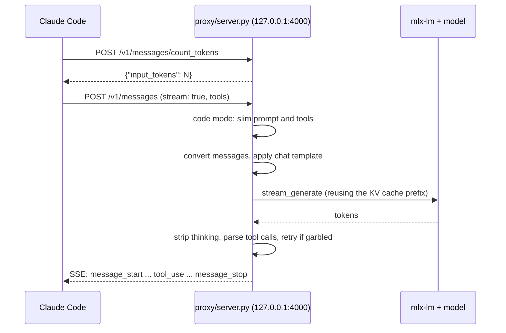

# How it works

## The big picture

Claude Code talks to Anthropic's Messages API. Most local model servers speak the OpenAI API, so a common setup puts a translating proxy between them. This project's server speaks the Anthropic format itself and runs the model in the same process with mlx-lm, so a request crosses one local HTTP hop and nothing else.



## The server

`proxy/server.py` is one file built on Python's standard `http.server` plus MLX and mlx-lm. It has no other dependencies. `setup.sh` installs it as a symlink, so the copy in the repo is the one that runs.

### 1. Loading the model

At startup it loads `MLX_MODEL` with `mlx_lm.utils.load`, caps MLX's buffer pool (`MLX_CACHE_LIMIT_GB`), and fixes two things models often get wrong:

- **Missing chat template.** If the tokenizer has none, the server injects a Gemma 4 style template.
- **Wrong stop token.** Some quantized repos have a `generation_config.json` whose end-of-sequence token differs from the tokenizer's. Generation then never stops and every reply runs to `max_tokens`. The server adds the tokenizer's `eos_token_id` to the stop set. The code comment names `divinetribe/Hermes-4-14B-abliterated-4bit-mlx` as the case that exposed this.

If `MLX_KV_BITS` is set and the model is a Gemma, KV quantization is switched off, because mlx-lm cannot quantize Gemma's sliding-window `RotatingKVCache`.

### 2. Shrinking Claude Code's prompt {#code-mode}

Claude Code sends a long system prompt and dozens of tool definitions written for Claude. The server's comments describe open models getting lost in it and replying with refusals such as "I am not able to execute this task". So by default:

- **Code mode** (on unless `MLX_CODE_MODE=0`): if the request contains any of Bash, Read, Edit, Write, Grep, Glob or Skill, the system prompt is replaced with a short coding prompt, every other tool is dropped, and each remaining tool is reduced to its name and parameter types. The prompt also tells the model that a `<command-name>` tag means "call the Skill tool", so Claude Code slash commands still work ([issue #54](https://github.com/nicedreamzapp/claude-code-local/issues/54)).
- **Browser mode** (`MLX_BROWSER_MODE=1`, takes priority): for requests carrying Chrome DevTools MCP tools, the prompt is replaced with a browser-agent prompt and only nine `mcp__chrome-devtools__*` tools are kept. Clients that bring their own prompt and no DevTools tools are passed through unchanged.
- **Append file** (`MLX_APPEND_SYSTEM_PROMPT_FILE`): extra text is appended after whichever mode ran.

`docs/BENCHMARKS.md` reports that slimming the tool descriptions cut prefill on Gemma 4 31B (M4 Pro, 64 GB) from about 60 s to about 2 s.

### 3. Converting messages

`convert_messages` turns the Anthropic conversation into plain chat messages:

- the system prompt (string or text blocks) becomes a `system` message;
- assistant `tool_use` blocks are written back as `<tool_call>{"name": ..., "arguments": ...}</tool_call>` text;
- each `tool_result` becomes a `tool` role message, with an `Error: ` prefix when `is_error` is true, and images or documents replaced by `[image omitted]` so base64 data never lands in the prompt.

Tools are converted to the Hugging Face function format and handed to the model's own chat template. If the template rejects the `tools` argument, the server writes the tools into the system prompt as text with explicit formatting rules. As a last resort it tokenizes a plain `role: content` transcript.

For Gemma models with `MLX_SUPPRESS_THINKING=1`, an empty thinking block is appended to the prompt so the model goes straight to its answer.

### 4. Reusing the KV cache

The server keeps one prompt cache and the token IDs it holds. On each request it counts how many leading tokens match the previous prompt, trims the cache back to that point using the cache's `.offset`, and prefills only the new tokens. At least one token is always left to prefill.

- A cache without `.offset` is never trimmed; the server does a full prefill instead.
- Gemma's `RotatingKVCache` cannot be trimmed safely, so Gemma gets a fresh cache each request in the server. (The Native Engine solves this differently, below.)
- An empty reply right after a cache hit is treated as corrupted state: the server logs a warning and drops the cache so the next request starts clean.

That last rule, and the switch from `.step` to `.offset`, came out of [issue #46](https://github.com/nicedreamzapp/claude-code-local/issues/46), where a long-lived server answered later sessions from the previous session's cache. Fixed in [v0.2.0](changelog.md#v020-2026-08-05).

### 5. Generating

Generation runs under a lock, so one request is processed at a time. Prefill happens in `MLX_PREFILL_SIZE` chunks (512 by default) to keep peak memory down. A `ThinkingFilter` removes Gemma 4 `<|channel>thought ... <channel|>` blocks token by token as they arrive. Stop sequences from the request are checked as text grows. After every generation, success or failure, the server clears MLX's buffer cache and logs the peak memory for that request, because a process killed for memory leaves no traceback.

### 6. Parsing tool calls

Local models write tool calls in many shapes. `parse_tool_calls` tries these in order and stops at the first that yields calls:

| Format | Example | Typical source |
|---|---|---|
| Gemma 4 native | `<|tool_call>call:Bash{command:<|"|>ls<|"|>}<tool_call|>`, also `<tool_call:Name{...}` and no `call:` prefix | Gemma 4 |
| Raw JSON object with `"type": "function"` | `{"type":"function","name":"Bash","parameters":{...}}` | Llama 3.3 |
| `<tool_call>` JSON, object or array | `<tool_call>{"name":"Bash","arguments":{...}}</tool_call>` | Qwen, Hermes and many others |
| `<function=Name><parameter=key>` XML | inside or outside `<tool_call>` | Qwen-style XML |
| `<|tool_call|> ... <|/tool_call|>` | | some model versions |
| `<tools> ... </tools>` JSON | | Qwen 2.5 fine-tunes |
| Fenced JSON block, one object, several objects, or an array | ```` ```json {...} ``` ```` | Qwen 2.5, Hermes 4 14B |
| Bare JSON object(s) as the whole reply | `{"name":"Bash","arguments":{...}}` | Qwen 2.5 Coder |
| Tagless `<parameter=...>` fragments | name guessed from `command`, `file_path` or `pattern` | garbled output |

Gemma 4 arguments are parsed as JSON after quoting keys and swapping its `<|"|>` string markers, so numbers, booleans, arrays and keys like `-i` survive. Arguments sent as a JSON-encoded string are decoded. Duplicate calls are removed only when both name and arguments match, so parallel reads of different files are kept. Malformed JSON goes through `recover_garbled_tool_json`, which handles hybrids like `{"name": "Bash", "parameter=command>ls`.

Parsing only runs when the request declared tools.

### 7. Retrying and cleaning up calls

If no call was parsed but the text looks like the model tried (it contains `<tool_call>`, `"arguments":`, ```` ```json ```` and similar), the server re-prompts up to `MLX_TOOL_RETRIES` times with the exact format to use. Retries run on a throwaway KV cache so the shared cache is not polluted.

Before replying, each call's arguments are filtered against the tool's `input_schema`, dropping keys the model invented. The code notes Claude Code silently rejects a `tool_use` with undeclared fields. Calls get IDs like `toolu_<24 hex>`, `stop_reason` becomes `tool_use`, and no empty text block is added in front, because the code notes that made Claude Code 2.1 discard the calls as "(No output)".

### 8. Answering

- **Non-streaming request:** plain JSON.
- **Streaming request with tools:** the whole answer is generated and parsed first, then replayed as the standard event sequence (`message_start`, `content_block_start`/`delta`/`stop` per block, `message_delta`, `message_stop`). The code notes Claude Code 2.1 asks for `stream: true` for tool requests and discards a non-streaming answer.
- **Streaming request without tools:** tokens go out as they are generated ([issue #39](https://github.com/nicedreamzapp/claude-code-local/issues/39)). A small holdback buffer makes sure stop markers and `<think>` blocks never reach the client, even when they are split across chunks.

`POST /v1/messages/count_tokens` runs the same conversion and tokenizer as a real request, so Claude Code's context meter matches what will actually be prefilled.

## The Native Engine

`agent/agent.py` is a separate, optional path: a terminal coding agent in one file that loads the model into its own process. No Claude Code, no HTTP.

Why it is faster on long sessions:

- **A fixed system prompt** of about 550 tokens (per the repo docs) that never changes, so the token prefix stays identical turn to turn.
- **Prefix reuse.** Each turn the chat template is re-rendered, the cache is trimmed to the first differing token with mlx-lm's `trim_prompt_cache`, and only the new tokens are prefilled.
- **The rotating-cache fix.** Gemma's sliding-window layers use a `RotatingKVCache` capped at the window (1024 tokens on Gemma 4). Once a conversation is longer than that, the cache reports it cannot be trimmed and every turn re-prefills the whole transcript. The engine swaps in a plain `KVCache` on every layer. The comment in the code says output is identical because the attention mask still enforces the window (checked with a greedy A/B on 2026-08-07), at the cost of those layers' cache growing with the conversation. The same comment records 6.5 to 7.2 s time to first token before and 0.37 s after on a 4.5k-token transcript (the README and the benchmark image say 0.36 s). `AGENT_ROLLING_KV=1` restores the stock behavior.
- **Early stop.** Generation stops as soon as `</function>` appears, since anything after a tool call is ignored anyway.

Tool calls use an XML dialect with raw-text values (`<function=Bash><parameter=command>ls</parameter></function>`), so code in arguments needs no JSON escaping. With `AGENT_DIALECT=native` the model's own chat template defines it (Qwen3-Coder); with `prompted` the format is described in the system prompt (Gemma 4). Values are coerced to the declared JSON schema type. With `AGENT_BACKEND=http` the same agent sends Anthropic requests to any local server, including `proxy/server.py`.

`bench/agent_bench.py` runs the same six-turn conversation twice, once with cache reuse and once wiping the cache each turn, and writes `bench_results.json`.

## Launchers and keep going

The launchers are thin bash wrappers. The shared library checks `/health`, restarts the server if a different model is loaded, prefers a local model folder over a download, finds the `claude` binary, and waits for the server. See [Configuration](configuration.md#launchers).

`keep going` reads Claude Code's own session files in `~/.claude/projects/` to find the latest conversation for the current folder, then runs `claude --resume <session-id>` against either OpenRouter or the local server.

## Tests

| Test | Needs a model? | Checks |
|---|---|---|
| `scripts/test_parse_tool_calls.py` | No | The tool-call parser against real model outputs |
| `scripts/test_convert_messages.py` | No | `tool_result` images and documents are not pasted as base64 |
| `scripts/test_http_errors.py` | No | 400 and 500 error bodies over a real socket |
| `scripts/test_generate_response.py` | No | Request handling with a fake model, including no-tools behavior |
| `scripts/test_stream_and_retry.py` | No | Live-stream filtering and the retry cache |
| `scripts/test_mlx_server.py` | Yes, a running server on port 4000 | 14 multi-step tool-call scenarios through the real model |

The model-free tests stub out the `mlx` modules, so they run on any machine with Python 3:

```bash
for t in parse_tool_calls convert_messages http_errors generate_response stream_and_retry; do
  python3 scripts/test_$t.py
done
```

All five printed `all checks passed` on the commit this site was built from. `docs/TOOL-CALL-RELIABILITY.md` reports 98 of 98 passes across 7 runs of `test_mlx_server.py` in March 2026, on the model the project shipped then.
