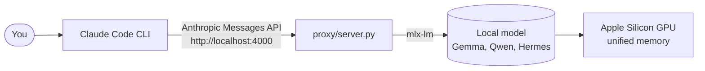

# Claude Code Local

**Claude Code, answered by a model running on your own Mac.**

Claude Code Local is a small Python server, [`proxy/server.py`](https://github.com/nicedreamzapp/claude-code-local/blob/main/proxy/server.py), that loads an open model with Apple's [MLX](https://github.com/ml-explore/mlx) and [mlx-lm](https://github.com/ml-explore/mlx-lm) and answers on `http://localhost:4000` in Anthropic's Messages API format. Point Claude Code at it with `ANTHROPIC_BASE_URL` and Claude Code reads files, edits code and runs commands as usual, while the model doing the thinking runs on the Mac's own chip.

*A real session from the repository's [`assets/demo.gif`](https://github.com/nicedreamzapp/claude-code-local/blob/main/assets/demo.gif): Claude Code reads and edits a file, and the model answering is running on the laptop.*

[Install it](install.md){ .md-button .md-button--primary } [Quickstart](quickstart.md){ .md-button }

## Who it is for

- You use **Claude Code** and want to keep working when you hit your usage limit, without a second subscription.
- You need code to **stay on your machine**: no model call leaves the Mac, and the launchers can switch off Claude Code's own background traffic.
- You have an **Apple Silicon Mac** (M1 or newer). The installer refuses to run anywhere else.
- You want to try **open models** (Gemma 4, Qwen 3.8, Hermes 4 and others) inside the agent you already know.

It is not for Windows, Linux or Intel Macs. See the [FAQ](faq.md#does-it-run-on-windows-linux-or-an-intel-mac) for alternatives.

## What is in the repository

| Piece | What it does |
|---|---|
| [`proxy/server.py`](how-it-works.md#the-server) | The MLX server. Speaks the Anthropic Messages API with streaming, turns each model's own tool-call format into Claude Code tool calls, repairs garbled tool JSON and reuses the prompt cache between turns. |
| [`launchers/`](configuration.md#launchers) | Double-click `.command` files for macOS that start the right model and open Claude Code against it. |
| [`agent/agent.py`](how-it-works.md#the-native-engine) | The Native Engine: a one-file terminal coding agent that loads the model in-process, with a short fixed system prompt so the KV cache survives every turn. |
| [`bin/keepgoing`](configuration.md#keep-going) | Finds your last Claude Code conversation in the current folder and resumes it on a free OpenRouter model or a local one. |
| [`install.sh`, `setup.sh`, `scripts/doctor.sh`](install.md) | Check the Mac, pick a model that fits its memory, install everything and put a launcher on the Desktop. |
| [`scripts/test_*.py`](how-it-works.md#tests) | Tests for the tool-call parser, message conversion, HTTP errors, streaming and retry. Most run without a model. |

## How the pieces connect

There is no OpenAI-format server and no translation proxy in the middle: the server speaks Claude Code's protocol directly. [How it works](how-it-works.md) walks through the request path.

## Which model you get

`setup.sh` reads the Mac's memory with `sysctl hw.memsize` and picks one model:

| Mac memory | Model installed by `setup.sh` | Approx. size |
|---|---|---|
| 96 GB and up | `lmstudio-community/Qwen3.8-27B-MLX-8bit` (Qwen 3.8 27B, 8-bit) | ~29 GB |
| 64 to 95 GB | `divinetribe/gemma-4-31b-it-abliterated-4bit-mlx` (Gemma 4 31B, 4-bit) | ~18 GB |
| 32 to 63 GB | `divinetribe/gemma-4-12B-it-abliterated-4bit-mlx-text` (Gemma 4 12B, 4-bit) | ~11 GB |
| 16 to 31 GB | `divinetribe/Hermes-4-14B-abliterated-4bit-mlx` (Hermes 4 14B, 4-bit) | ~8 GB |
| Under 16 GB | `mlx-community/gemma-4-e4b-it-4bit` (Gemma 4 E4B, 4-bit) | ~5 GB |

Sizes are the labels printed by `setup.sh`. The repository notes that the under-16 GB model "claimed to run a file it never wrote" in a Claude Code smoke test on 2026-09-19, so expect unreliable tool calls on the smallest tier. A user confirmed Hermes 4 14B on a 16 GB Mac in [issue #54](https://github.com/nicedreamzapp/claude-code-local/issues/54).

## Measured results in the repo

Every number below comes from the repository's own docs, measured by the maintainer on an Apple M5 Max with 128 GB. Your Mac will differ.

- **Native Engine turn start:** time to first token on a 4.5k-token conversation with Gemma 4 31B 4-bit dropped from 6.5 to 7.2 s to **0.36 s** after the KV cache fix described in [How it works](how-it-works.md#the-native-engine). Reproduce with `python3 bench/agent_bench.py`.
- **Qwen 3.8 27B 8-bit:** 17.9 tok/s plain decode, and it passed the Claude Code smoke test (write `hello.py`, run it, report) in 38 s on 2026-09-19.
- **Gemma 4 31B 4-bit:** 26 tok/s in the Agent-12 runs.
- **Memory:** a comment in `proxy/server.py` records MLX peak memory on a 21.4k-token prompt with Gemma 4 31B 4-bit: 34.2 GB with an 8192-token prefill chunk, 20.9 GB with 1024. The default chunk is now 512.

Agent-12 leaderboard scores come from Agent-12's own lean test harness, not from inside Claude Code; the README says so plainly, and the same model can score and time differently in Claude Code. Full tables and methodology: [docs/BENCHMARKS.md](https://github.com/nicedreamzapp/claude-code-local/blob/main/docs/BENCHMARKS.md) and the [Agent-12 leaderboard](https://nicedreamzapp.github.io/agent12/).

## Built on

Claude Code is Anthropic's. MLX and mlx-lm are Apple's. The models come from Google, the Qwen team, Nous Research and others. This repository adds the server, launchers, Native Engine and installers that connect them. Full list on the [Credits](project-credits.md) page.

## More guides on GitHub

These longer guides live in the repository's `docs/` folder:

- [Full technical guide](https://github.com/nicedreamzapp/claude-code-local/blob/main/docs/FULL-GUIDE.md): every model table, benchmark and design note
- [Benchmarks](https://github.com/nicedreamzapp/claude-code-local/blob/main/docs/BENCHMARKS.md) and [Tool-call reliability](https://github.com/nicedreamzapp/claude-code-local/blob/main/docs/TOOL-CALL-RELIABILITY.md)
- [Voice mode](https://github.com/nicedreamzapp/claude-code-local/blob/main/docs/VOICE-MODE.md), [Browser agent](https://github.com/nicedreamzapp/claude-code-local/blob/main/docs/BROWSER-AGENT.md), [Phone control](https://github.com/nicedreamzapp/claude-code-local/blob/main/docs/PHONE-CONTROL.md), [MCP servers](https://github.com/nicedreamzapp/claude-code-local/blob/main/docs/MCP-SERVERS.md)
- [Mac base / Pro 16 GB setup notes](https://github.com/nicedreamzapp/claude-code-local/blob/main/docs/MAC-BASE-SETUP.md) (Portuguese, contributed in PR #32)
